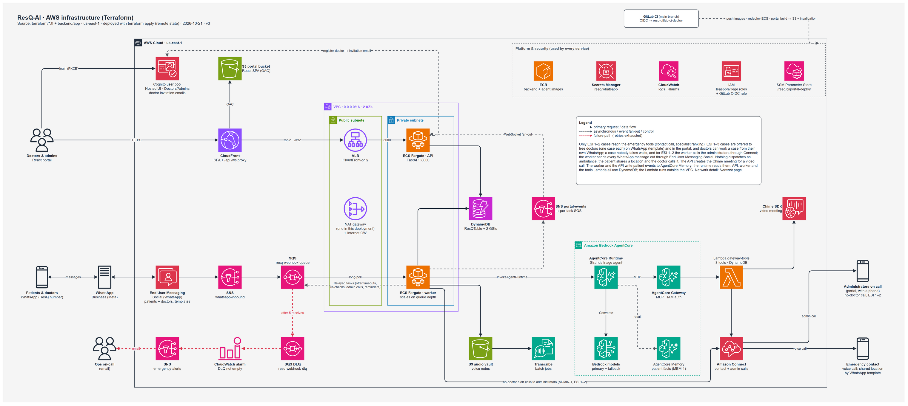

# ResQ-AI

[](https://dqk2eev1ghqhn.cloudfront.net/)
[](https://dqk2eev1ghqhn.cloudfront.net/healthz)
[](https://wa.me/923212164421)
[](https://youtu.be/SiEbjOteNJ8)
[](https://aws-cds-partner.devpost.com/)
[](LICENSE)
[](https://github.com/amaanx86/resq-ai/commits/main)

[](#where-end-user-messaging-social-fits-in)
[](#how-it-works)
[](https://strandsagents.com/)
[](#how-it-works)
[](#how-it-works)


Emergency help over WhatsApp, in Urdu, Hindi and English. We built it for the AWS Communication Developer Services (CDS) Agentic AI Partner Hackathon.

Live portal: <https://dqk2eev1ghqhn.cloudfront.net/> (doctors and admins sign in with Cognito)

API health check: <https://dqk2eev1ghqhn.cloudfront.net/healthz>

Demo video (3 minutes): <https://youtu.be/SiEbjOteNJ8>

Try it on WhatsApp: message **+92 321 2164421** (<https://wa.me/923212164421>). Say hi, register an emergency contact in your own words, then describe an emergency in Urdu, Hindi or English, typed or as a voice note.

## Why we built this

When someone collapses at home in Karachi or Lahore, the person next to them is not going to open a hospital app or fill in a form. They are going to panic, and then they are going to do what they always do: send a WhatsApp voice note, probably in Urdu.

So that is the whole interface. You send a voice note (or a text, or a photo of the injury) to the ResQ number. The system works out how serious it is, phones your emergency contact if it is critical, asks you to share your location, and gets a real doctor onto the same WhatsApp chat. Nobody installs anything.

## How it works

A message arrives through AWS End User Messaging Social and is queued in SQS. A worker on ECS picks it up, saves any voice note or photo to S3, and runs Amazon Transcribe on voice notes. Transcribe has no Urdu model, so we run Urdu through the Hindi one and relabel it, which works better than you would expect because spoken Urdu and Hindi are so close. Photos go to a Bedrock vision model, which describes what it sees.

The transcript (or photo description) goes to a triage agent built with Strands Agents, running on Amazon Bedrock AgentCore Runtime. It returns an ESI level from 1 (resuscitation) to 5 (non-urgent), the likely specialty, and a reply in the patient's own language. AgentCore Memory gives it what we know about the patient from earlier cases. We only let that history push a case towards more urgent, never less.

For ESI 1 and 2, the agent calls two tools at once through the AgentCore Gateway, both backed by a Lambda function. One places an Amazon Connect call to the emergency contact, with a Polly voice reading the alert in their language. The other ranks the free doctors for the right specialty. The patient gets a reply and a WhatsApp "Send location" button. ESI 3 gets advice and a doctor's review, and ESI 4 and 5 get advice only.

Doctors are offered the case on WhatsApp with Accept and Decline buttons (and as a popup in the portal). For the critical levels, three free doctors are asked at once and whoever accepts first gets it. If nobody is free, the patient is told to stay on the chat, admins are alerted (with a Connect call for ESI 1 and 2), and the case goes to the first doctor who frees up.

From there the doctor can stay entirely in WhatsApp. Their messages, photos and voice notes are relayed to the patient through the ResQ number, and they run the case with short commands like `@resq video` or `@resq close`. The web portal is there if they prefer it. Video calls use the Amazon Chime SDK and the patient joins from a link in the browser.

We deliberately do not dispatch ambulances automatically. When the patient shares their location, it goes to the doctor with a map link and to the emergency contact as a WhatsApp template. The doctor calls the ambulance and marks it in the case, and the patient gets a message saying help is coming.



There are more diagrams in [architecture/](architecture/), including the [full inbound message flow](architecture/resq-inbound-flow.drawio.png) and the [use cases](architecture/resq-use-cases.drawio.png).

## Where End User Messaging Social fits in

WhatsApp through End User Messaging Social is the only channel any of our users touch: patients, their families and doctors all talk to one business number.

Inbound events from the number go to an SNS topic, which feeds the SQS queue the worker reads. Outbound, we call `SendWhatsAppMessage` for plain replies, reply buttons, location requests, call-to-action links (the video room, one-time call links) and templates. `GetWhatsAppMessageMedia` pulls patients' voice notes and photos straight into S3, and `PostWhatsAppMessageMedia` sends the doctor's photos and voice notes back. We manage six message templates in Terraform: the location alert to the emergency contact, the doctor case offer, doctor number confirmation, a "patient is waiting" nudge for doctors outside the 24-hour window, and two incoming-call notices.

The relay matters more than it sounds. A doctor's messages are routed to their one open case and forwarded from the ResQ number, so the chat never hands out the patient's number or the doctor's.

The provider code is in `backend/app/messaging/providers.py` (`EumSocialProvider`), inbound parsing in `backend/app/messaging/inbound.py`, and the templates in `terraform/whatsapp_templates.tf`. For local development the same code can talk to the Meta Cloud API instead.

## Keeping the AI honest

An emergency system cannot trust the model blindly, so the guardrails live in code. The tools take the case ID and ESI level from our code, not from the model, and refuse to run unless the case really is ESI 1 or 2. Each tool runs at most once per case (we keep idempotency keys in DynamoDB), so a retried message never calls someone's family twice. If the agent skips a tool it should have used, a safety net in code runs it. And if Bedrock is down, triage falls back to a second model and then to a keyword classifier, which is marked as degraded on the case.

## Stack

Messaging runs on AWS End User Messaging Social, voice calls on Amazon Connect and Polly, AI on Amazon Bedrock with AgentCore Runtime, Gateway and Memory, plus Amazon Transcribe. The API and the worker are separate ECS Fargate services on arm64, the Gateway tools are a Lambda function, and events move through SNS and SQS (with a dead-letter queue and an alarm). Data lives in a single DynamoDB table and an S3 media bucket. The portal is React 19 on S3 and CloudFront with Cognito sign-in, and video uses the Chime SDK. Everything is Terraform, and GitLab CI deploys through OIDC, so there are no stored AWS keys.

## Running it locally

You don't need an AWS account for this. Docker Compose starts the API, the worker, the portal and Floci, an emulator for DynamoDB, S3, SQS and SNS.

```bash
cp .env.example .env
docker compose up -d
```

Open <http://localhost:5173> for the portal (no login locally) and <http://localhost:8000/docs> for the API. Click "Simulate voice note" and try the Urdu cardiac case:

> Mere uncle ko dil ka daura par raha hai, seene me shadeed dard hai, please jaldi ambulance bhejein!

It comes back as ESI 1. The emergency contact call is placed (simulated locally) and the case is offered to the cardiologist. Accept it from the case card and you can chat as the doctor. A mild cold ("Mujhe kal se halka sa zukam aur sar dard hai") comes back as ESI 5 with advice only.

Locally there is no Bedrock or Transcribe, so triage uses the keyword classifier, and calls and video are simulated. To test with your own phone, see [docs/whatsapp-testing.md](docs/whatsapp-testing.md). The backend tests run without any AWS access:

```bash
cd backend
pip install -r requirements.txt
python -m pytest tests -q
```

## Deploying to AWS

The full runbook is in [docs/deployment.md](docs/deployment.md). In short: build the Gateway Lambda zip, create the ECR repositories, push the two images, link your WhatsApp number in End User Messaging Social, run `terraform apply`, and point the number's event destination at the SNS topic. After that, CI handles backend and portal deploys from `main`.

## Repo layout

`backend/` has the FastAPI API, the SQS worker, the agents, the AgentCore Runtime app and the Gateway Lambda. `frontend/` is the React portal. `terraform/` is the AWS infrastructure, one file per area. `architecture/` has the diagrams, and `docs/` has the architecture write-up, the deployment runbook, local testing guides and the demo script.

## License

Apache 2.0, see [LICENSE](LICENSE).
