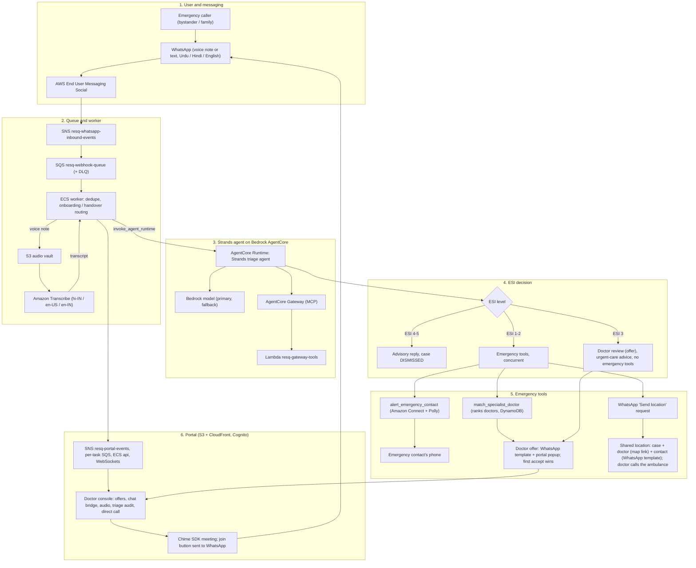
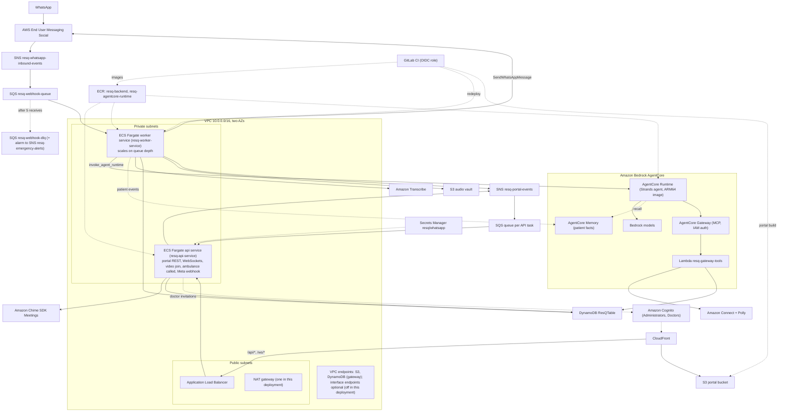
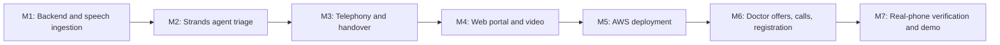

# ResQ-AI: Multilingual Emergency Response Platform
## Technical Architecture and Implementation Plan

> **Status:** built and deployed on AWS (`us-east-1`) with Terraform; GitLab CI deploys the backend and the portal. Beyond the original plan, ResQ-AI now has doctor case offers, direct WhatsApp calls through the doctor's own number, emergency-contact registration in the patient's own words, patient memory on AgentCore Memory, and portal invitations for doctors. Items the original plan listed that were not built are in §9. The owner decisions behind the architecture are in §10. The deploy runbook and the verification checklist are in `docs/deployment.md`.

---

## 1. Executive Summary and Vision

**ResQ-AI** is an emergency medical triage and response system built on AWS. Its purpose is to cut the delay when a critical event occurs (cardiac arrest, stroke, severe trauma, anaphylaxis).

### Core problem and user journey
* **The user's situation:** a family member collapses ("My uncle is having a heart attack"). In panic, people cannot navigate hospital apps or fill in forms. They open WhatsApp, which is already on their phone, and send a voice note in **Urdu, Hindi, or English**.
* **What ResQ-AI does:** it transcribes the voice note with Amazon Transcribe, runs clinical triage with a **Strands Agents** agent on **Amazon Bedrock AgentCore Runtime**, and assigns an Emergency Severity Index (ESI) level:
  * **ESI 4-5 (non-emergency, e.g. mild cold):** no emergency services are alerted; the case is logged and the user gets safe guidance.
  * **ESI 3 (urgent):** no emergency tools; the case is offered to a doctor for review and the user is told to seek urgent care.
  * **ESI 1-2 (true emergency):** two actions run concurrently, then the patient is asked for their location:
    1. **Call the registered emergency contact** through **Amazon Connect** with a spoken message (**Amazon Polly**) in the caller's language.
    2. **Rank the on-duty specialist doctors** by current load. The case is then **offered** to the top doctors (WhatsApp template with Accept / Decline, plus a portal popup), and the first to accept takes over the WhatsApp conversation.
    3. **Ask for the location** with a WhatsApp interactive "Send location" button. The shared location goes on the case, to the doctor (Google Maps link) and to the emergency contact (approved WhatsApp template `resq_emergency_location`).
  * **No automatic ambulance dispatch:** the doctor calls the ambulance (1122) and records it in the portal ("Mark ambulance called"), which tells the patient on WhatsApp. If no doctor is available, the patient is told to call 1122 / 115. A CAD partner integration is future work (§9).
* **Teleconsultation and video:** the doctor sees the voice note, transcript and triage reasoning in the portal, chats with the patient over the WhatsApp bridge, and can start a video consultation: an **Amazon Chime SDK** meeting whose join link is sent to the patient's WhatsApp as a button.
* **Calls:** the patient can ask for a call; the doctor gets a one-time link that opens the patient's WhatsApp chat and calls from their own number (calls answered in the portal wait for Meta to allow WhatsApp calling on the number).
* **Admin and doctor web portal:** doctor registration with Cognito invitations, each doctor's own on/off duty switch, case offers, the live emergency console, monthly analytics and case history, behind Amazon Cognito login.

---

## 2. AWS and AI Technology Stack

| Functional layer | Service / architecture | Notes |
| :--- | :--- | :--- |
| **Agent framework** | **Strands Agents SDK** (`strands-agents`) | Two phases: a classification agent returns a structured `TriageDecision`; for ESI 1-2 only, an emergency agent calls the two emergency tools (contact call, specialist handover). |
| **Agent deployment** | **Amazon Bedrock AgentCore** Runtime, Gateway and Memory | The agent runs as an AgentCore Runtime container (ARM64). Its tools are exposed through the AgentCore Gateway (MCP, IAM/SigV4 auth) backed by a Lambda function. AgentCore Memory keeps facts about each patient across cases (MEM-1); they can only raise urgency. AgentCore Identity and Evaluations are not used. |
| **Foundation models** | Amazon Bedrock via the Converse API (Strands `BedrockModel`) | Primary `BEDROCK_MODEL_ID` (a Claude Sonnet model), fallback `BEDROCK_FALLBACK_MODEL_ID` (Amazon Nova Pro), then a keyword classifier marked "degraded". The same models read free-form emergency-contact registrations (Strands structured output). |
| **Speech** | **Amazon Transcribe** batch jobs with language identification | WhatsApp OGG Opus audio is transcribed directly from S3. Amazon Transcribe has no Urdu language code, so the options are `hi-IN`, `en-US`, `en-IN`; spoken Urdu is transcribed as Hindi and re-labelled as Urdu from its vocabulary. Nova Sonic is not used (§9). |
| **WhatsApp** | **AWS End User Messaging Social** (production), Meta WhatsApp Cloud API (local development) | One setting, `WHATSAPP_PROVIDER=eum_social|meta`, chooses the provider; everything downstream is the same. Templates (location alert, doctor case offer) are managed by Terraform. WhatsApp calling is configured by Terraform but off until Meta allows it on the number. |
| **Telephony** | **Amazon Connect** + **Amazon Polly** | Outbound call to the emergency contact; the contact flow speaks the `SpokenMessage` attribute. |
| **Teleconsultation** | **Amazon Chime SDK Meetings** + `amazon-chime-sdk-js` | Browser video room, no app install; link delivered as a WhatsApp interactive button. |
| **Data** | **Amazon DynamoDB** single table + **Amazon S3** audio vault | Users, doctors, cases, chat messages, monthly metric counters, idempotency records. |
| **Compute** | **Amazon ECS Fargate**: `api` and `worker` services, fed by **Amazon SQS** | The API serves the portal; the worker processes inbound WhatsApp messages and delayed internal tasks (doctor-offer timeouts). |
| **Portal and identity** | **S3 + CloudFront**, **Amazon Cognito** | Hosted UI login; registering a doctor creates their Cognito user and Cognito emails the invitation. |
| **Delivery** | **GitLab CI** with an OIDC role, Terraform (remote state) | CI builds the arm64 images, redeploys ECS and uploads the portal; everything else changes through `terraform apply`. |

---

## 3. End-to-End System Architecture and Data Flow



---

## 4. Component Specifications

### 4.1. WhatsApp ingestion
* **Production:** AWS End User Messaging Social publishes inbound WhatsApp events to SNS `resq-whatsapp-inbound-events`, which delivers to SQS `resq-webhook-queue`. The worker unwraps the SNS envelope and parses the inner WhatsApp `entry[].changes[].value.messages[]` payload into an `InboundWhatsAppMessage`.
* **Local development:** the Meta Cloud API calls `POST /api/v1/webhook` (optionally checked with `X-Hub-Signature-256`). The API parses the payload into the same `InboundWhatsAppMessage` and only enqueues it.
* **Media:** voice notes are downloaded to `s3://<audio vault>/voice-notes/...` (`socialmessaging.get_whatsapp_message_media` in production, the Graph API locally).
* **Button taps:** a registered doctor's Accept / Decline on an offer, and a patient's **Request a call**, are handled before anything else; other taps count as typing the button's title.
* **Idempotency:** each message is claimed by provider message ID; the case ID is derived from it, so an SQS redelivery cannot call the emergency contact twice. The worker deletes the SQS message only after success; failures retry and then go to the DLQ.
* **Onboarding:**
  * An unknown sender gets a profile with status `PENDING_DETAILS` and no emergency contact.
  * The bot asks for the emergency contact's name and number in the user's own words, typed or in a voice note (e.g. "My brother Ali, 0333 1234567"). Voice notes go through Amazon Transcribe, a Bedrock model extracts the details (`app/registration.py`), and local numbers are read in the sender's country.
  * An emergency is never delayed by onboarding: voice notes and other messages are triaged first, the contact call is skipped if no contact is on file, and the onboarding prompt is sent after the emergency reply.

### 4.2. Multilingual speech pipeline (Urdu, Hindi, English)
WhatsApp voice notes are OGG with Opus compression, which Amazon Transcribe accepts directly.
```python
transcribe.start_transcription_job(
    TranscriptionJobName=f"resq-triage-{timestamp}-{random}",
    Media={"MediaFileUri": f"s3://{bucket}/voice-notes/{key}.ogg"},
    MediaFormat="ogg",
    IdentifyLanguage=True,
    LanguageOptions=["hi-IN", "en-US", "en-IN"],   # override: TRANSCRIBE_LANGUAGE_OPTIONS
)
```
* The worker polls the job (every `TRANSCRIBE_POLL_INTERVAL_SECONDS`, up to `TRANSCRIBE_TIMEOUT_SECONDS`).
* **Urdu:** Amazon Transcribe has no Urdu language code. Spoken Urdu comes back as `hi-IN` and is re-labelled Urdu from its words. Spoken Urdu and Hindi are close, but transcription quality for Urdu has not been measured.
* **Failure:** if transcription fails or times out, the case is flagged `needs_human_review` (ESI 2, HIGH, General Emergency doctor, no contact call, location requested) and the patient is asked to resend or type.
* **Text messages:** language is detected from script and keywords, without extra dependencies.
* Bedrock models read Urdu, Hindi and English (native script or romanized) without a translation step.

### 4.3. Strands agent and Amazon Bedrock AgentCore
The agent lives in `backend/app/agents/core.py` and runs in two places with the same code:
* **In-process** (`AGENT_BACKEND=local`): mock mode, Floci and tests. Without Bedrock it uses the keyword classifier.
* **AgentCore Runtime** (`AGENT_BACKEND=agentcore`, the ECS worker): the worker calls `bedrock-agentcore` `invoke_agent_runtime` with the transcript, language, patient and case ID. The runtime (`backend/agent_runtime/`, `BedrockAgentCoreApp`, ARM64, port 8080) runs the agent and reaches its tools through the AgentCore Gateway `resq-tools-gateway` (MCP over HTTPS, SigV4) with the Lambda target `resq-gateway-tools` (`backend/gateway_tools/`). If the runtime call fails, the worker triages in-process and marks the case degraded.

How a triage runs:
1. **Classify:** a Strands `Agent` with no tools returns a structured `TriageDecision` (ESI level, emergency flag, specialty, clinical summary, reasoning, confidence). Model order: primary, fallback, keyword classifier (`degraded=True`).
2. **Emergency tools (ESI 1-2 only):** a Strands agent with two `@tool`s, `alert_emergency_contact` and `match_specialist_doctor`, which run concurrently. A code safety net runs any required tool the model skipped. There is no ambulance tool.
3. **Guards:** tools take the case ID, ESI level and patient details from code (`invocation_state`), never from the model. The contact call refuses unless the ESI level is 1 or 2, and each tool runs at most once per case (DynamoDB `IDEMPOTENCY#tool:{case}:{tool}`).

The Gateway Lambda also exposes `generate_video_session` (three tools in total).

### 4.4. ESI decision rules
```markdown
You are the ResQ-AI Clinical Emergency Triage Agent. Transcripts arrive in Urdu, Hindi or English.

1. ESI 1-2 (true emergency): crushing chest pain, heart attack ("dil ka daura"), cardiac arrest,
   stroke signs (facial droop, slurred speech), unconsciousness, severe seizure, massive bleeding,
   severe crash, major burns, severe breathing distress, choking, anaphylaxis.
   -> alert_emergency_contact, match_specialist_doctor
      (Cardiology, Neurology, Trauma, Pulmonology, General Emergency); the doctor arranges the ambulance.
2. ESI 3 (urgent): needs prompt care but not an ambulance (e.g. persistent vomiting with pain).
   -> no tools; a doctor reviews the case and the patient is advised to seek urgent care.
3. ESI 4-5 (non-emergency): mild headache, cold, cough without breathlessness, general advice, greetings.
   -> no tools; polite guidance recommending a regular clinic visit.
```

### 4.5. Telephony, location and the ambulance
* **Emergency contact call:** Amazon Connect `StartOutboundVoiceContact` to the registered contact. The contact flow speaks the `SpokenMessage` attribute with Amazon Polly in Urdu, Hindi or English, for example:
  * *Urdu:* "ایمرجنسی الرٹ! آپ کے عزیز [نام] کے لیے ایک ہنگامی طبی صورتحال رپورٹ ہوئی ہے۔ ایک اسپیشلسٹ ڈاکٹر کیس دیکھ رہا ہے اور ایمبولینس کا انتظام کرے گا۔ مریض کی لوکیشن ملتے ہی آپ کو واٹس ایپ پر بھیج دی جائے گی۔" (sent in Devanagari for the Hindi Polly voice)
  * *Hindi:* "आपातकालीन चेतावनी! आपके परिजन [नाम] के लिए एक आपातकालीन स्थिति दर्ज हुई है। एक विशेषज्ञ डॉक्टर मामला देख रहे हैं और एम्बुलेंस की व्यवस्था करेंगे। मरीज़ का लोकेशन मिलते ही आपको व्हाट्सऐप पर भेज दिया जाएगा।"
  * *English:* "Emergency Alert! A critical medical situation has been reported for your contact [Name]. A specialist doctor is handling the case and will arrange an ambulance. The patient's location will be sent to you on WhatsApp once they share it."
* **Location request:** after the ESI 1-2 reply the patient gets a WhatsApp interactive "Send location" button (`location_request_message`). A shared `location` message on the open case is saved on it (`location_latitude/longitude/name/address/shared_at`), posted to the doctor's chat with a Google Maps link and, when the emergency protocol ran, sent to the emergency contact as the approved UTILITY template `resq_emergency_location` ({{1}} patient name, {{2}} map link). Business-initiated messages need a template because the contact has usually never messaged the number. The result is `location_alert_status` (SENT / FAILED / SKIPPED_NO_CONTACT); a failure is shown in the chat for the doctor.
* **Ambulance:** nothing is dispatched automatically. The doctor calls 1122 from the portal's "Patient location & ambulance" tile and clicks "Mark ambulance called" (`POST /api/v1/cases/{id}/ambulance-called`), which records `ambulance_called_at/_by` and tells the patient on WhatsApp.
* In real AWS mode a failed call is recorded as FAILED, never as a success. The Connect instance, outbound flow and number can be created by Terraform (`create_connect_instance = true`).

### 4.6. Doctor offers and the WhatsApp handover bridge
1. **Doctors:** an administrator registers a doctor (name, phone, email, license number, specialty, bio); the API creates the doctor's Cognito user and Cognito emails the invitation. Each doctor switches themselves on or off duty in the portal (off duty: no new offers, open cases stay).
2. **Ranking:** `match_specialist_doctor` (and `rank_candidates` in `app/agents/tools.py`) returns the FREE active doctors only (one case per doctor: a doctor with an open case or a pending offer for another case is skipped), the fewest lifetime `cases_handled` first, in tiers: the required specialty, General Emergency, then any active doctor. Triage never assigns a doctor.
3. **Offers:** every open case that needs a doctor (ESI 1-3, human review) is offered in rounds: the top 3 free doctors at once for ESI 1-2, one doctor for ESI 3, with a timeout of 60 / 60 / 300 s for ESI 1 / 2 / 3 (`DOCTOR_OFFER_*`, Terraform `doctor_offer_*`), and no round limit. Each offered doctor is locked to the case first (a conditional write on the doctor), so two cases never reach the same doctor. Offered doctors get the `resq_doctor_case_offer` template (Accept / Decline; interactive buttons if the template send fails) and a portal popup, and see the case read-only. Every transition is a conditional write on the round's `offer_id`, so one accept wins and stale timeouts do nothing. A decline by the whole round or a timeout starts the next round. With no free doctor left the case waits (`EXHAUSTED`): the patient is told to stay on the chat (and to call 1122 / 115 if it gets worse), administrators are alerted (portal banner; a Connect call for ESI 1-2, repeated until acknowledged), and the case is offered again as soon as a doctor is free; an administrator can also assign one. Accept: `assigned_doctor_id/_name`, `accepted_at`, `cases_handled + 1`, a WhatsApp to the patient (with **Request a call**) and the case card on the doctor's WhatsApp.
4. **Handover:** an ESI 1-2 case starts in `DOCTOR_HANDOVER`, ESI 3 in `ACTIVE`. While a user has an open case, every message they send (text or voice note, audio kept) goes into that case's chat for the doctor: no triage, no tools, no new case. Doctor replies go to the patient's WhatsApp, from the portal or from the doctor's own WhatsApp (they message the ResQ number; `@resq ...` messages are commands, `docs/design/doctor-whatsapp.md`), and the patient's messages reach the doctor's WhatsApp too. The bot's replies are also saved in the chat.
5. **Resolve:** the doctor clicks "Resolve case" (`POST /api/v1/cases/{id}/resolve`); the next message starts a new triage.
6. **Live updates:** the worker and API publish case and message events to SNS `resq-portal-events`; each API task has its own SQS queue subscribed to it and pushes events to its WebSocket clients (`/ws/cases`, `/ws/bridge/{caseId}`).

### 4.7. Video consultation (Amazon Chime SDK)
* The doctor clicks **"Start video call"** on the console. The API creates a Chime SDK meeting and stores it on the case.
* The patient receives a WhatsApp interactive **"Join video call"** button (link also in the text): `{PORTAL_BASE_URL}/call/{meetingId}?role=patient&case={caseId}&token={secret}`. The doctor's link has no token and requires portal login.
* The link opens the standalone mobile `VideoRoom` page, which uses `amazon-chime-sdk-js`; attendees are created by `POST /api/v1/video/{meetingId}/join`.
* `PORTAL_BASE_URL` must be public HTTPS (phone browsers block camera and microphone on HTTP except localhost). Chime ends a meeting about 5 minutes after the last attendee leaves; the link then returns 410 and the doctor starts a new call.
* Without real AWS (mock or Floci) a labelled simulated room is used (`CHIME_MODE=auto|mock|aws`).
* **Direct WhatsApp calls** (`app/direct_calls.py`): until WhatsApp calls can ring in the portal (CALL-1, blocked on Meta), the patient's **Request a call** button (or a WhatsApp call to the business number) sends the assigned doctor a one-time **Open chat & call** link (`DIRECTCALL#<token>`, the patient's number never appears in the message). Opening it, or the portal's **Call on WhatsApp** button, notes the call on the case, tells the patient the doctor is calling from their own number and redirects to `wa.me/<patient>`.

### 4.8. Admin and doctor web portal
* **Frontend stack:** React 19, Vite 6, Tailwind CSS 3, Lucide React, Axios, `amazon-chime-sdk-js` 3.x. The analytics charts are hand-built (Recharts is not used).
* **Hosting and security:** S3 + CloudFront (which also routes `/api/*` and `/ws/*` to the ALB). Amazon Cognito Hosted UI with authorization code + PKCE; the ID token is sent as a Bearer token (and `?token=` on WebSockets). Groups: **Administrators** see everything; **Doctors** see only cases assigned to them (`custom:doctor_id`) plus, read only, cases currently offered to them, have no analytics or registration tabs, read only their own profile and can only toggle their own availability.
* **Doctor workspace:** incoming offer popup (countdown, Accept / Decline) and the "Doctor offer" card, voice note playback (presigned S3 URLs), transcript and detected language, the live chat bridge, patient and emergency contact details, the triage audit (summary, reasoning, confidence, engine, tool results), the "Patient location & ambulance" tile (shared location with a map link, whether it reached the emergency contact, "Call 1122", "Mark ambulance called"), "Call on WhatsApp", "Start video call" and "Resolve case".
* **Doctor registration:** name, mobile number, email, license number, specialty, bio. The roster shows each doctor's portal status (invited, with **Resend invitation**, or portal access) and on-duty state. Doctors switch themselves on or off duty in the navigation.
* **Analytics (one month at a time):** registered users, ESI 1-2 emergencies vs. ESI 3 urgent vs. ESI 4-5 false alarms, cases by language, specialty and doctor, and the **average response time** (from voice note received to the ESI 1-2 protocol run: contact called, specialists ranked), measured from real cases and shown as "n/a" when there is no data. The design target is under 5 seconds; nothing has been measured on AWS yet. Demo padding only with `DEMO_MODE=true`, shown with a "Demo data" badge.
* **Case history:** searchable cases with audio playback, transcript, agent reasoning, tool results and the patient-doctor conversation.

---

## 5. Amazon DynamoDB Single-Table Schema (`ResQTable`)

Table name **`ResQTable`**, on-demand billing. GSI1 `GSI_SpecialtyActive`, GSI2 `GSI_Analytics`.

| Entity | PK | SK | GSI1 PK / SK | GSI2 PK / SK | Main attributes |
| :--- | :--- | :--- | :--- | :--- | :--- |
| **User profile** | `USER#<phone>` | `PROFILE` | - | - | `name`, `emergency_contact_name`, `emergency_contact_phone`, `onboarding_status`, `active_case_id`, `registered_at` |
| **Doctor profile** | `DOCTOR#<doc_id>` | `PROFILE` | `SPECIALTY#<spec>` / `STATUS#ACTIVE\|INACTIVE` | - | `name`, `phone_number`, `email`, `license_no`, `specialty`, `bio`, `is_active`, `cases_handled`, `portal_status`, `portal_invited_at` |
| **Doctor phone pointer** | `DOCTORPHONE#<e164>` | `PROFILE` | - | - | `doctor_id` (finds the doctor behind an offer button tap) |
| **Case** | `CASE#<case_id>` | `METADATA` | `STATUS#<status>` / `DATE#<YYYY-MM-DD>` | `MONTH#<YYYY-MM>` / ISO timestamp | `user_phone`, `audio_s3_key`, `transcript`, `detected_language`, `esi_level`, `severity`, `status`, `assigned_doctor_id`, `clinical_summary`, `reasoning`, `triage_engine`, `degraded`, `tool_results`, `patient_history`, `received_at`, `dispatched_at`, `video_meeting`; offer state (`doctor_offer_status`, `offer_id`, `offered_doctor_ids`, `declined_doctor_ids`, `offer_expires_at`, `offer_history`, `accepted_at`); location (`location_requested_at`, `location_latitude/longitude/name/address/shared_at`, `location_alert_status`), `ambulance_called_at/_by`; calls (`call_requested_at`, `direct_call_at/_by`) |
| **Chat message** | `CASE#<case_id>` | `MSG#<timestamp>#<msg_id>` | - | - | `sender` (PATIENT/DOCTOR/BOT), `content`, `audio_s3_key`, `provider_message_id`, `timestamp` |
| **Monthly metric** | `METRIC#<YYYY-MM>` | `SUMMARY` | - | - | counters `cases_total`, `esi_1_2`, `esi_3`, `esi_4_5`, `lang#<language>`, `spec#<specialty>`, `doc#<doctor>` (atomic ADD on first save) |
| **Idempotency** | `IDEMPOTENCY#<key>` | `LOCK` | - | - | `status`, lease; keys `msg:{provider}:{message_id}`, `sender:{phone}` and `tool:{case_id}:{tool}` |
| **Direct-call link** | `DIRECTCALL#<token>` | `LINK` | - | - | `case_id`, `doctor_id`, `expires_at`, `ttl` (DynamoDB TTL) |

---

## 6. AWS Cloud Infrastructure Architecture



Both ECS services use the same backend image (`uvicorn app.main:app` vs. `python -m app.worker`), with separate task roles: the worker has SQS receive/delete/send (delayed tasks), Transcribe, S3, DynamoDB, End User Messaging Social, Bedrock (registration reading), AgentCore invoke and memory permissions; the API has what the portal needs, including Chime and the Cognito admin calls for doctor invitations.

---

## 7. Verification and Testing Plan

### 7.1. Automated tests (done, mock mode)
494 pytest tests in `backend/tests` cover: inbound parsing for Meta and EUM Social sample payloads (both must produce the same `InboundWhatsAppMessage`), button taps and call events, the outbound providers with stubbed clients, the worker's SQS handling, idempotency and internal tasks, free-form registration (numbers, scripts, emergencies, model fallback), onboarding and handover routing, Transcribe polling and language re-labelling, agent parsing, model fallback, ESI guards and concurrency, AgentCore, Gateway and Memory clients, doctor ranking and offers (rounds, accept / decline races, timeouts, EXHAUSTED), direct-call links, Cognito invitations, analytics metrics, portal auth and Chime video. Run with `cd backend && PYTHONIOENCODING=utf-8 python -m pytest tests -q`.

### 7.2. Speech tests (to do on AWS)
* Urdu voice note (*"Meri ammi ko seene me shadeed dard hai aur behosh ho gayi hain"*): check Transcribe returns `hi-IN`, the case is labelled Urdu, and the transcript is usable for triage.
* Hindi voice note (*"Uncle ko heart attack aa gaya hai, saans lene me dikkat ho rahi hai"*): check `hi-IN`.
* English voice note (*"My uncle collapsed, I think he is having a cardiac arrest"*): check `en-US` or `en-IN`.

### 7.3. Agent tests (covered locally; repeat on AWS with real models)
* Cardiac emergency: the two tools run, with `Cardiology`, the case is offered to cardiologists first, and the "Send location" button follows the reply.
* ESI 3: no tools, the case is offered to one doctor for review.
* Registration: "Mera naam Ahmed hai, agar mujhe kuch ho jaye to mere bhai Ali ko call karna, unka number zero three three three ..." (typed and spoken) registers Bhai Ali with a +92 number and opens no case.
* Non-emergency (*"Mujhe halka sa zukam hai, kal doctor ka appointment chahiye"*): no ambulance, no call, no doctor.

### 7.4. Telephony and video (to do on AWS)
* Amazon Connect: the contact's phone rings and the Polly message plays in the right language.
* Chime: the meeting is created and the WhatsApp link opens the room on a phone browser over HTTPS.
* Direct call: **Request a call** gives the doctor an **Open chat & call** link that opens the patient's WhatsApp chat.

---

## 8. Implementation Roadmap



1. **Milestone 1 (built):** FastAPI API and SQS worker, WhatsApp providers (End User Messaging Social and Meta), S3 voice vault, Amazon Transcribe.
2. **Milestone 2 (built):** Strands agent with structured ESI decisions, Bedrock model fallback, AgentCore Runtime and Gateway with Lambda tools, AgentCore Memory.
3. **Milestone 3 (built):** Amazon Connect + Polly, doctor ranking, WhatsApp handover bridge, WhatsApp location sharing with a doctor-called ambulance (the CAD webhook was removed; see §9).
4. **Milestone 4 (built):** React 19 / Tailwind portal with Cognito login, live console, doctor registration, analytics, case history, Chime SDK video.
5. **Milestone 5 (done):** deployed with Terraform (remote state); GitLab CI deploys the images, the ECS services and the portal.
6. **Milestone 6 (built and deployed):** doctor case offers (WhatsApp template + portal popup), direct WhatsApp calls through the doctor's own number, emergency-contact registration in the patient's own words (Bedrock + Transcribe), portal invitations for doctors, doctors' own duty switch.
7. **Milestone 7 (done):** end-to-end checks on real phones in Urdu, Hindi and English (`docs/deployment.md` step 11).

---

## 9. Future Work (in the original plan, not built)

* **Amazon Nova Sonic real-time speech (SPEECH-2):** not implemented. Recommendation: keep it out of scope. Nova Sonic is a streaming speech-to-speech model that suits a live call channel, not complete OGG voice notes, and its Urdu/Hindi support is unverified. Revisit if a live voice channel is added.
* **WhatsApp calls answered in the portal (CALL-0..2, replaces VIDEO-2):** Blocked: Meta allows calling only on numbers with a 2,000+ daily messaging limit. Until then the direct-call fallback (§4.7) is used, and Chime SDK meetings stay the only video path.
* **AgentCore Identity and Evaluations:** not used.
* **Native Urdu speech recognition:** depends on Amazon Transcribe adding an Urdu language code, or on another speech engine.
* **CAD partner integration (after the hackathon):** not part of the hackathon build. There, no ambulance is dispatched automatically. The patient shares a location through a WhatsApp location request, the location goes to the emergency contact (WhatsApp template) and to the assigned doctor in the portal, and the doctor calls the ambulance. Later, ResQ-AI will partner with a computer-aided dispatch (CAD) provider and build an API with them:
  * **Trigger:** the CAD receives an alert when the patient allows location sharing (the WhatsApp location message on an open ESI 1-2 case). It is not sent at triage time, when the location is still unknown.
  * **Alert payload:** case ID as a stable reference (so the CAD can de-duplicate retries), ESI level and emergency type, latitude/longitude plus the address and name if WhatsApp includes them, patient name and phone, emergency contact, and the assigned doctor.
  * **Status back from the CAD:** accepted, unit assigned, ETA, en route, arrived. Each update is saved on the case, shown in the portal and sent to the patient on WhatsApp.
  * **Still open, to agree with the partner:** authentication (API key or signed requests), retries and failure handling (an alert that fails falls back to the doctor calling), live location updates, and which cities and providers are covered.
  * **Reuse:** the doctor keeps the "Ambulance called" action as a manual fallback. The removed CAD webhook adapter (`telephony_service.dispatch_ambulance_cad`, before this change) is in git history as a starting point.

---

## 10. Owner decisions

These decisions fix the architecture. They were made while auditing the first version (2026-10-11) and planning the WhatsApp features (2026-10-15).

| Item | Decision |
|---|---|
| AGENT-1 | **Strands Agents SDK** for the triage agent. |
| AGENT-2 | **Deploy the agent on Bedrock AgentCore** (Runtime, tools through the AgentCore Gateway). |
| AGENT-5 | **Only ESI 1-2 run the emergency protocol** (contact call, specialist handover). ESI 3 gets a doctor's review, no tools. |
| INFRA-6 | **Separate API and worker ECS services**, fed by SQS. |
| INFRA-7 | **AWS End User Messaging Social** for WhatsApp in production; the Meta Cloud API locally. One setting (`WHATSAPP_PROVIDER`) switches them. |
| LOC-1 (2026-10-13) | **No automatic ambulance dispatch.** The patient shares a WhatsApp location; the doctor calls the ambulance. A CAD partner API comes after the hackathon (§9). |
| MEM-1 | **AgentCore Memory** for patient history; it may only raise urgency, never lower it, and never delays ESI 1-2. |
| OFFER-1 | **Doctors accept a case before it is assigned to them.** Offers go out on WhatsApp and in the portal; the first accept wins. (Rounds changed 2026-10-21, OFFER-3.) |
| OFFER-3 (2026-10-21) | **ESI 1-2 go to the top 3 free doctors at once, 60 s per round, then the next 3, and so on**; ESI 3 to one doctor at a time, 5 min; no round limit. |
| OFFER-4 (2026-10-21) | **One case per doctor, offers included:** a doctor never holds two cases or an offer while they hold a case. |
| OFFER-5 / ADMIN-1 (2026-10-21) | **No free doctor: the patient waits** ("stay on this chat", and 1122 / 115 if it gets worse); the case goes to the next free doctor. Administrators get a portal alert for every case without a doctor, and a Connect call for ESI 1-2. |
| ADMIN-2 (2026-10-21) | **Administrators are added in the portal, each with a phone number** for the no-doctor calls (on / off per administrator); `admin_alert_phone_numbers` stays for fixed numbers. Administrators also edit and unregister doctors and delete closed cases. |
| DOC-8 (2026-10-21) | **A doctor confirms their WhatsApp number before any case** (template with Yes / No). No login over WhatsApp: the confirmed number is the doctor's identity for `@resq` commands. |
| UI (2026-10-21) | **The portal follows the SUDO brand:** navy #204d9b and bright blue #189cd9, Poppins and Noto Sans, few colours (severity and state only). |
| DOC (2026-10-21) | **Doctors can work a case from their own WhatsApp:** messages to the ResQ number are relayed to their patient as they are (no model), `@resq ...` messages are commands (fixed ones, plus a Bedrock agent for free-form ones that can only run the same commands). The portal stays as it is and is optional. |
| CALL-1 / CALL-3 | **The patient calls the ResQ number and the doctor answers in the portal** (browser WebRTC). Fallback: the doctor calls the patient from their own WhatsApp through a one-time link. Not building a media relay between two WhatsApp users. |
| SPEECH-2, VIDEO-2 | **Not building** Nova Sonic real-time speech or a separate WhatsApp video mode (§9). |
| Infrastructure | **Terraform is the source of truth** for everything in AWS; hand-made resources are imported. |
