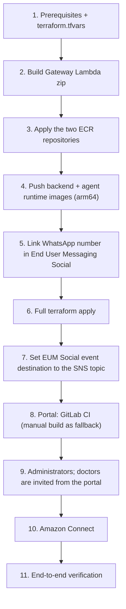

# ResQ-AI: AWS Deployment Runbook

How to deploy ResQ-AI into an AWS account with Terraform, verify it end to end, and roll out later changes. For a local run without AWS, see [local-testing-floci.md](local-testing-floci.md).

Terraform is the source of truth for everything in AWS. The reference deployment runs in `us-east-1`.

---

## Deployment runbook



Commands below use bash (Git Bash works on Windows; prefix commands whose arguments start with `/` with `MSYS_NO_PATHCONV=1`) and assume `us-east-1`. Run Terraform commands from `terraform/`. Every apply goes through a saved plan: `terraform plan -out=tfplan`, review it with `terraform show tfplan`, then `terraform apply tfplan`.

### Step 1: Prerequisites and variables
- AWS CLI with credentials for the target account (`aws sts get-caller-identity`).
- Terraform 1.5 or later, Docker with `buildx` (arm64 builds need QEMU emulation on an x86 machine), Python 3.12/3.13, Node.js.
- Amazon Bedrock model access for the models you set in `bedrock_model_id` and `bedrock_fallback_model_id`. They are used for triage and for reading free-form registrations.
- `cp terraform.tfvars.example terraform.tfvars` and fill it in. Keep secrets out of the file; use `TF_VAR_whatsapp_*` environment variables for them. Set `seed_demo_data = false` unless you want the demo doctors and cases in the deployment.
- This deployment sets:
  - `ecs_cpu_architecture = "ARM64"`, because GitLab CI builds arm64 images;
  - `single_nat_gateway = true` and `enable_interface_endpoints = false`, to save cost (see `architecture/resq-aws-infrastructure-network.drawio.png`);
  - `create_connect_instance = true`;
  - `gateway_lambda_architecture = "arm64"`.

### Step 2: Build the Gateway Lambda zip
```bash
python backend/scripts/build_gateway_lambda.py --arch arm64     # matches gateway_lambda_architecture
```
This writes `backend/build/gateway_tools.zip`, which Terraform reads. It needs network access to PyPI. Without `--arch` it installs x86_64 wheels, which need `gateway_lambda_architecture = "x86_64"`.

### Step 3: Create the ECR repositories
Remote state goes to an S3 bucket you create beforehand. Copy `backend.hcl.example` to `backend.hcl` (gitignored) and set the bucket name.
```bash
cp backend.hcl.example backend.hcl
terraform init -backend-config=backend.hcl
terraform plan -out=tfplan -target=aws_ecr_repository.resq_backend -target=aws_ecr_repository.agentcore_runtime
terraform apply tfplan
```
The AgentCore Runtime cannot be created before its image exists, so the repositories come first.

### Step 4: Build and push the two images
GitLab CI does this on every `main` push that touches `backend/` (see Redeploys). By hand, for the first deploy:
```bash
BACKEND_REPO=$(terraform output -raw ecr_backend_repository_url)     # .../resq-backend
AGENT_REPO=$(terraform output -raw ecr_agentcore_repository_url)     # .../resq-agentcore-runtime
REGISTRY=${BACKEND_REPO%%/*}
aws ecr get-login-password --region us-east-1 | docker login --username AWS --password-stdin "$REGISTRY"

cd ../backend
# API + worker image (arm64, matches ecs_cpu_architecture = "ARM64")
docker buildx build --platform linux/arm64 --provenance=false -t "$BACKEND_REPO:latest" --push .
# AgentCore Runtime image (AgentCore requires arm64)
docker buildx build --platform linux/arm64 --provenance=false -f agent_runtime/Dockerfile -t "$AGENT_REPO:latest" --push .
cd ../terraform
```
If the outputs are empty after the targeted apply, get the URIs with `aws ecr describe-repositories --repository-names resq-backend resq-agentcore-runtime`.

### Step 5: Link the WhatsApp number in AWS End User Messaging Social
Production uses End User Messaging Social (`whatsapp_provider = "eum_social"`, the default in the tfvars example).
1. Open the **AWS End User Messaging Social** console in the deployment region and choose **Add WhatsApp phone number**.
   - Complete the Meta embedded sign-up: link or create the WhatsApp Business Account (WABA) and add the number.
   - The number must not be linked to another WhatsApp Business setup.
2. Copy the AWS phone number ID (`phone-number-id-...`) into `eum_social_phone_number_id` in `terraform.tfvars`. Without it, `terraform plan` stops on a precondition and the backend refuses to start.
3. Add a payment method in Meta Business Manager. Start with a test number, then switch to the production number.
4. The event destination is set in step 7, after the SNS topic exists. You can leave it empty during sign-up.
5. Set `eum_social_waba_id` in `terraform.tfvars` to the WABA ID. It is the last part of the WABA ARN; this deployment uses `waba-8acf738629354f5db63bcd7ed8128fa3` in us-east-1. `terraform apply` then creates the WhatsApp templates defined in `whatsapp_templates.tf`:
   - `resq_emergency_location`: the location alert to the emergency contact;
   - `resq_doctor_case_offer`: the doctor case offer with Accept / Decline;
   - `resq_incoming_patient_call` and `resq_incoming_patient_call_portal`: an incoming patient call (for CALL-1).

   All four are APPROVED by Meta (2026-10-18).

   How the templates are managed:
   - No Terraform resource exists for them, so a `terraform_data` runs `scripts/whatsapp_template.py` with the AWS CLI. It needs `python` (`local_python`) and the AWS CLI on the machine running terraform, with the same `AWS_PROFILE`.
   - It creates missing templates, updates changed ones in place and never deletes (Meta blocks a deleted name for 30 days).
   - Meta reviews each new or changed template, usually within minutes. Check with `aws socialmessaging list-whatsapp-message-templates --id waba-...`.
   - Until a new or changed template is APPROVED, sends that need it fail. For the location alert, the case shows `location_alert_status = FAILED` and the doctor sees a note in the chat. A doctor offer falls back to interactive buttons, which only reach doctors inside the 24-hour window.
6. WhatsApp calling is set by `whatsapp_calling.tf` (`whatsapp_calling_enabled`, off). Meta allows calling only on numbers with a messaging limit of at least 2,000 business-initiated conversations a day. This number is below that, so patient calls go the direct way (**Request a call** sends the doctor an **Open chat & call** link).

Notes:
- Replies only reach the patient inside WhatsApp's 24-hour customer-service window. That holds because every flow starts with the patient's message.
- Voice notes are written to S3 as `voice-notes/<timestamp>_<phone>_<rand>_<mediaId>.ogg`.
- The IAM action prefix is `social-messaging`; the boto3 client is `socialmessaging`.

### Step 6: Full `terraform apply`
```bash
terraform plan -out=tfplan
terraform show tfplan     # review
terraform apply tfplan
```
This creates:
- the VPC, with S3/DynamoDB gateway endpoints and, unless they are switched off, interface endpoints for bedrock-runtime, transcribe, ecr.api, ecr.dkr, logs, secretsmanager, sqs and sns;
- the ALB (idle timeout 300 s for WebSockets);
- the ECS cluster `resq-ai-cluster` with `resq-api-service` and `resq-worker-service`;
- DynamoDB, S3, SNS/SQS and Secrets Manager `resq/whatsapp`;
- the AgentCore Runtime, Gateway and Memory, and the Gateway Lambda `resq-gateway-tools`;
- Cognito (with the ResQ-AI invitation email) and CloudFront;
- the GitLab CI deploy role with its SSM parameter `/resq/ci/portal-deploy`;
- the WhatsApp templates and, optionally, Amazon Connect.

Settings that differ from local Docker are set in the ECS task definitions; there is no `.env` file in AWS:

| Setting | Local Docker | AWS API service | AWS worker service |
|---|---|---|---|
| `MOCK_AWS` | `False` (with `AWS_ENDPOINT_URL`) | `False` | `False` |
| `AWS_ENDPOINT_URL` | `http://floci:4566` | not set | not set |
| `WHATSAPP_PROVIDER` | `meta` | `eum_social` | `eum_social` |
| `EUM_SOCIAL_PHONE_NUMBER_ID` | not used | from tfvar `eum_social_phone_number_id` | same |
| `AGENT_BACKEND` | `local` | not used | `agentcore` + `AGENTCORE_RUNTIME_ARN`, `AGENTCORE_GATEWAY_URL` |
| `AGENTCORE_MEMORY_ID` | not set (memory off) | set when `agentcore_memory_enabled` | same |
| `COGNITO_USER_POOL_ID` | not set (invitations skipped) | the Terraform user pool | not used |
| `DOCTOR_OFFER_*` | defaults (45 / 60 / 300 s, top 3 for ESI 1, 3 rounds) | tfvars `doctor_offer_*` | same |
| `SEED_DEMO_DATA` | API `True`, worker `False` | tfvar `seed_demo_data` | always `False` |
| `AUTH_ENABLED` | `False` | tfvar `auth_enabled` (default true) | not used |
| `PORTAL_BASE_URL` | `http://localhost:5173` | `https://<CloudFront domain>` unless `portal_base_url` is set | same |

`PORTAL_BASE_URL` must be public HTTPS in AWS: phone browsers block the camera and microphone on plain HTTP (except localhost).

Outputs you will use:

| Output | Used for |
|---|---|
| `portal_url`, `cloudfront_domain_name` | The portal, and `PORTAL_BASE_URL` for video and direct-call links |
| `cloudfront_distribution_id`, `portal_bucket`, `vite_build_env` | Portal build and upload (CI reads them from SSM `/resq/ci/portal-deploy`) |
| `audio_vault_bucket` | Voice notes |
| `cognito_user_pool_id`, `cognito_client_id`, `cognito_domain` | Administrators and the portal login |
| `whatsapp_inbound_topic_arn` | EUM Social event destination (step 7) |
| `webhook_queue_url`, `webhook_dlq_url` | Inbound queue and DLQ |
| `ecs_cluster_name`, `ecs_api_service_name`, `ecs_worker_service_name` | Redeploys |
| `api_log_group`, `worker_log_group`, `agentcore_log_group` | Logs |
| `agentcore_runtime_arn`, `agentcore_gateway_url`, `gateway_tools_lambda_name`, `agentcore_memory_id` | AgentCore checks |
| `connect_instance_id`, `connect_contact_flow_id`, `connect_source_phone_number` | Connect settings in use |
| `meta_webhook_url`, `whatsapp_verify_token` (sensitive) | Only for the Meta rollback |

CloudFront serves the portal from S3 and routes `/api/*`, `/ws/*` and `/healthz` to the ALB, with no caching.
- The ALB accepts only CloudFront. Its security group allows the CloudFront origin-facing prefix list, and its listener forwards only requests that carry CloudFront's secret `X-Origin-Verify` header; anything else gets 403.
- A CloudFront Function rewrites extension-less paths to `/index.html`, so `/call/...` video links load the portal without turning API 404s into HTML.

### Step 7: Set the End User Messaging Social event destination
In the End User Messaging Social console, open the WABA and set its event destination to the SNS topic ARN from `terraform output -raw whatsapp_inbound_topic_arn` (`resq-whatsapp-inbound-events`).
- Terraform applies a topic policy that allows `social-messaging.amazonaws.com` to publish.
- If events do not arrive, first remove the policy's `aws:SourceAccount` condition in `messaging.tf` and apply again.

Events flow from SNS through SQS `resq-webhook-queue` to the worker. Failed messages are retried and move to `resq-webhook-dlq` after 5 receives (visibility timeout 300 s). The same queue carries the worker's delayed internal tasks (doctor-offer timeouts).

### Step 8: The portal
GitLab CI's `deploy-portal` job builds and uploads the portal whenever `frontend/` changes on `main` (see Redeploys). For the first deploy, or if CI is unavailable, build it by hand:
```bash
cd ../frontend
# Write the Cognito build settings from Terraform into .env.production
terraform -chdir=../terraform output -json vite_build_env \
  | python -c "import json,sys; print('\n'.join(f'{k}={v}' for k,v in json.load(sys.stdin).items()))" > .env.production
npm ci
npm run build
aws s3 sync dist/ "s3://$(terraform -chdir=../terraform output -raw portal_bucket)" --delete
aws cloudfront create-invalidation \
  --distribution-id "$(terraform -chdir=../terraform output -raw cloudfront_distribution_id)" --paths "/*"
```
The portal is then at `terraform output -raw portal_url` (`https://<cloudfront_domain_name>`).

### Step 9: Administrators and doctors
Self sign-up is off. Users set their password at the first Hosted UI login and cannot edit `custom:doctor_id`.

**Administrators** are created by hand:
```bash
POOL=$(terraform output -raw cognito_user_pool_id)
aws cognito-idp admin-create-user --user-pool-id "$POOL" --username admin@hospital.org \
  --user-attributes Name=email,Value=admin@hospital.org Name=email_verified,Value=true Name="name",Value="Ops Admin"
aws cognito-idp admin-add-user-to-group --user-pool-id "$POOL" --username admin@hospital.org --group-name Administrators
```

**Doctors** need no Cognito step:
- An administrator registers the doctor in the portal (**Doctors** tab) with their email. The API creates the Cognito user (`Doctors` group, `custom:doctor_id`, `custom:role`, `custom:specialty`).
- Cognito emails the ResQ-AI invitation (template in `terraform/templates/portal_invite_email.html`) with a temporary password valid 7 days.
- The roster shows **Resend invitation** until the doctor has set their password. `GET /api/v1/doctors` asks Cognito about invited doctors and switches them to "Portal access".
- **Invite to portal** adds an email to a doctor registered without one.
- An email that already has a Cognito user is linked to the doctor instead. No email is sent if that user already set a password.
- Invitations go through Cognito's own mailer (`no-reply@verificationemail.com`, 50 emails a day) because the account's SES is in the sandbox.

What doctors can do in the portal:
- They see the cases assigned to them, plus the cases currently offered to them (read only, with Accept / Decline).
- They have no analytics or registration tabs.
- They switch themselves on or off duty in the navigation. Off duty means no new offers; cases they already have stay with them.

### Step 10: Amazon Connect
Either:
- set `create_connect_instance = true` and apply (this deployment). Terraform creates the instance and an outbound contact flow that speaks `$.Attributes.SpokenMessage` with Amazon Polly, and claims a phone number (`connect_phone_number_country_code`, `connect_phone_number_type`). The account is at its Connect instance quota, so a failed apply that deletes the instance needs a support case or a restore; or
- create them by hand (outbound flow with a Play prompt block, text-to-speech from the `SpokenMessage` contact attribute). Then set `connect_instance_id`, `emergency_contact_phone_flow_id` and `connect_source_phone_number` and apply.

Outbound calls to some countries need a country allow-list or service-quota change in the Connect console (done for Pakistan and India in this deployment). A failed call shows as FAILED on the case; there is no fake success in AWS.

The call's language follows the emergency contact's calling code: +92 hears the Urdu message, +91 the Hindi one, and other countries the patient's language (`call_language` in `backend/app/agents/core.py`). This is needed because Transcribe has no Urdu model and often labels Urdu voice notes Hindi. A patient who wrote in English always gets an English call. Polly has no Urdu voice, so Kajal (hi-IN) reads Urdu written in Devanagari.

### Step 11: End-to-end verification
Infrastructure and portal:
- [ ] `curl "$(terraform output -raw api_endpoint)/healthz"` returns `{"status":"HEALTHY",...}` (through CloudFront; the ALB answers direct requests with 403).
- [ ] Both ECS services run. The API log shows `[WhatsApp] Provider: eum_social` and the worker log shows `[Worker] Polling <queue URL>`.
- [ ] The portal loads over HTTPS and an invited doctor can set their password and sign in.
- [ ] The doctor sees only their own and offered cases; an administrator sees everything; the duty switch changes the roster.

WhatsApp and speech:
- [ ] A real WhatsApp message goes from EUM Social through SNS and SQS to the worker, and the reply reaches the phone.
- [ ] A real voice note's audio lands in S3 and plays in the console (presigned URL), and Transcribe returns a transcript for Urdu, Hindi and English (Urdu comes through the Hindi model; check the quality).
- [ ] A real photo (an injury, with and without a caption) lands in S3 `images/`, the image analysis agent describes it (`image_analysis.engine` is `bedrock:<model>`), the case is triaged from the description, and the console shows the photo with the "AI photo summary". A photo sent on an open case appears in the doctor's chat.
- [ ] From the console, the doctor sends a photo (📎) and records a voice note (🎤) in Chrome and Safari: both reach the patient's WhatsApp (the voice note arrives as a WhatsApp voice message from every browser: the server converts it to mono OGG/Opus; a `Delivery of ... failed` line in the API / worker logs means WhatsApp dropped it) and show in the chat.
- [ ] A new number registers its emergency contact in its own words, typed and as a voice note. The confirmation arrives and no case is opened. A message that also reports an emergency is triaged with the contact on file.

Triage and the emergency protocol:
- [ ] The worker reaches the AgentCore Runtime (`triage_engine` starts with `agentcore/`), and the Runtime calls the tools through the Gateway (`tool_results` show `backend: gateway`).
- [ ] An ESI 1-2 case rings the emergency contact's phone with the Polly message, and the patient gets a "Send location" button after the reply.
- [ ] Doctor offers:
  - the case reaches a doctor's phone as the `resq_doctor_case_offer` template and as the portal popup;
  - Accept on the phone assigns the doctor and tells the patient;
  - an ESI 1-2 case goes to 3 free doctors at once; a decline by all of them or the 60 s timeout moves it to the next 3, with no round limit (ESI 3: one doctor, 5 min);
  - a doctor who holds a case or an offer is never offered a second one (two cases at the same moment, three doctors: nobody gets two);
  - with nobody free left, the patient is told to wait (and to call 1122 / 115 if it gets worse), the case is offered automatically when a doctor closes theirs or comes on duty, and an administrator can assign (409 for a busy doctor).
- [ ] No-doctor alerts (ADMIN-1), with no doctor on duty:
  - an ESI 1 case shows the red banner, the alarm and a browser notification to a signed-in administrator;
  - the administrator's real phone rings with the English message ("An ESI level 1 case has no doctor assigned ..."), and again 5 minutes later;
  - **Acknowledge** in the portal stops the alarm and the next calls; an ESI 3 case gets the banner but no call.
- [ ] Administrators and doctors managed in the portal (ADMIN-2, DOC-8):
  - **Administrators** tab: adding an administrator emails the Cognito invitation, they sign in and see the admin tabs; their phone rings for the no-doctor call while **Alert calls** is on and not when it is off; removing them takes them out of the Administrators group;
  - registering a doctor sends the `resq_doctor_confirm_number` template (after Meta approves it) to their phone; until they tap **Yes, it's me** the roster shows "Number not confirmed" and they get no offers; **No, not me** shows the warning and the number is treated as a patient's;
  - editing a doctor's number asks the new number again; unregistering a doctor removes their portal access and their WhatsApp messages open a patient case again;
  - deleting a closed case in Case History removes it, its chat and its voice notes / photos in S3, and the month's analytics drop by one.
- [ ] Doctors on WhatsApp (DOC-*), from a real doctor's phone:
  - after Accept, the doctor gets the case card and what the patient said so far;
  - the doctor's text, photo and voice note reach the patient from the ResQ number, and show in the portal chat;
  - the patient's text, photo (with the AI summary), voice note (with the transcript) and shared location (a map pin) reach the doctor;
  - `@resq video` sends both links and the doctor joins from their phone without the portal login; `@resq ambulance called` and `@resq close` ask to confirm and then work; `@resq hand over` gives the case to the next doctor;
  - a free-form command on Bedrock ("@resq patient ko video call bhejo") runs the right action;
  - a doctor silent for more than 24 hours gets the `resq_doctor_patient_waiting` template (after Meta approves it), and **Show messages** brings the patient's messages;
  - a message from a doctor whose case closed recently gets "case closed" and opens no case.
- [ ] The patient taps **Request a call**: the assigned doctor gets an **Open chat & call** link, opening it tells the patient and opens `wa.me/<patient>`, and the chat notes it.
- [ ] Sharing a location (the button, or 📎 > Location) shows it in the doctor's console with a map link and delivers the `resq_emergency_location` template to the emergency contact (`location_alert_status = SENT`). "Mark ambulance called" records it on the case and reaches the patient's WhatsApp.
- [ ] A text sent while the case is open appears in the doctor's console, and the doctor's reply reaches WhatsApp. "Resolve case" closes the case, and the next message starts a new triage.
- [ ] The doctor starts a video call, and the patient's WhatsApp button opens the room on a phone browser with camera and microphone.

Reliability and data:
- [ ] Killing a worker task mid-message leads to a retry, not a lost or duplicated case. A message that keeps failing lands in the DLQ and triggers the alarm.
- [ ] The analytics tab shows a measured average response time.
- [ ] Patient memory (MEM-1):
  - After a first case, `aws bedrock-agentcore list-memory-records --memory-id "$(terraform output -raw agentcore_memory_id)" --namespace /patients/patient-<digits>/facts` shows extracted facts. Extraction is asynchronous, so allow a minute.
  - The patient's next case shows the facts under "Patient History" in the console.

Known limits to keep in mind:
- Amazon Transcribe has no Urdu language code, so Urdu goes through `hi-IN`.
- A killed API task leaves its portal-events SQS queue and SNS subscription behind. There is no reaper; at most 5 minutes of events are kept.
- Chime ends a meeting about 5 minutes after the last attendee leaves. The old link then returns 410 and the doctor starts a new call.
- It is unverified whether Floci honours `ReturnValues=ALL_OLD` on PutItem. If it does not, the local monthly counters over-count re-saved cases; AWS is not affected.

### Redeploys
What GitLab CI does (`.gitlab-ci.yml`, runs on `main`, AWS access through the OIDC role `resq-gitlab-ci-deploy` from `ci_oidc.tf`; set `AWS_ACCOUNT_ID` as a project CI/CD variable):
- **Changes under `backend/` or the CI file:** builds the backend and agent-runtime images (arm64), pushes each as `:<short sha>` and `:latest`, and force-redeploys **both ECS services**.
- **Changes under `frontend/` or the CI file:** `deploy-portal` builds the portal with the settings Terraform keeps in SSM `/resq/ci/portal-deploy` (the `vite_build_env` output, the bucket and the distribution), uploads it to S3 and invalidates CloudFront. When both changed, it runs after the ECS deploy.

CI does **not** touch the AgentCore Runtime, the Gateway Lambda, the Gateway tool schemas or the ECS config in Secrets Manager; those need `terraform apply` (below). A change like the location-sharing release (tool removed, new settings) therefore needs three things after CI:
1. the gateway zip rebuilt;
2. `agentcore_image_tag` set to the CI's short SHA;
3. one `terraform apply`.

- **Backend code (manual alternative to CI):** build and push the backend image, then force a new deployment of **both** ECS services:
  ```bash
  CLUSTER=$(terraform output -raw ecs_cluster_name)
  aws ecs update-service --cluster "$CLUSTER" --service "$(terraform output -raw ecs_api_service_name)" --force-new-deployment
  aws ecs update-service --cluster "$CLUSTER" --service "$(terraform output -raw ecs_worker_service_name)" --force-new-deployment
  ```
- **Agent runtime:** set `agentcore_image_tag` to the new tag (CI pushes `resq-agentcore-runtime:<short sha>`) and `terraform apply`.
  - The runtime is managed by Terraform, not ECS, and Terraform only sees a change when the image URI changes. Pushing a new `:latest` alone leaves the runtime on its old image.
- **Gateway tools:** rerun `build_gateway_lambda.py --arch arm64` and `terraform apply` (the Lambda uses the zip's hash).
  - A change to `backend/gateway_tools/tool_schemas.json` also updates the Gateway target. Deploy the gateway zip, the agent runtime image and the backend image together, so no old component calls a tool that is gone.
- **Portal:** CI's `deploy-portal` job (above); step 8 is the manual alternative.
- **Settings and templates:** tfvars (for example `doctor_offer_*`) and `whatsapp_templates.tf`, then `terraform apply`. ECS rolls both services through the `resq.config-hash` label.
- Optional: set `ops_alert_emails` and confirm the SNS email, to receive the DLQ alarm from `emergency_alerts_topic_arn`.

### Rolling back to the Meta Cloud API
1. Set `whatsapp_provider = "meta"` and `whatsapp_phone_number_id`, and pass the Meta token via `TF_VAR_whatsapp_access_token`. Then apply; the values go into Secrets Manager `resq/whatsapp`.
2. In the Meta developer console, point the webhook at `terraform output -raw meta_webhook_url` (`https://<cloudfront>/api/v1/webhook`) with the verify token from `terraform output -raw whatsapp_verify_token`, and subscribe to `messages`.
