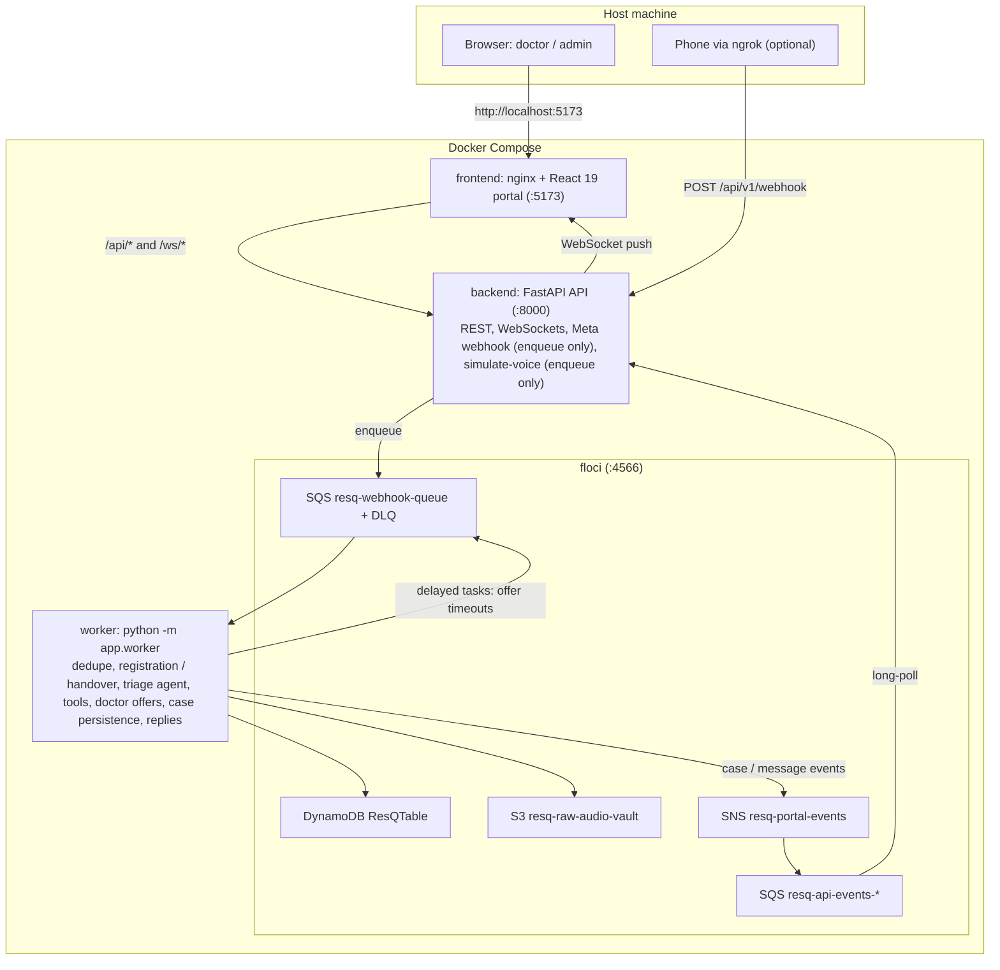

# ResQ-AI: Local Testing with Floci (AWS Emulator)

This guide runs the whole ResQ-AI stack locally, with **Floci** standing in for AWS. You need no AWS account and touch no deployed resources.

---

## 1. What Floci emulates here

**[Floci](https://floci.io)** is an open-source AWS emulator that speaks the AWS wire protocol on port `4566`, so boto3 works against it unchanged.

In ResQ-AI, Floci provides:
1. **DynamoDB**: `ResQTable` with `GSI_SpecialtyActive` and `GSI_Analytics` (auto-created by the backend).
2. **S3**: the voice-note bucket `resq-raw-audio-vault` (auto-created).
3. **SQS**:
   - the inbound queue `resq-webhook-queue`, which also carries the delayed internal tasks such as doctor-offer timeouts;
   - its DLQ `resq-webhook-dlq` (auto-created, maxReceiveCount 5);
   - one portal-events queue per API container (`resq-api-events-<host>-<rand>`).
4. **SNS**: the portal-events topic `resq-portal-events` (auto-created), which fans worker events out to the API.
5. **IAM**: accepted but not enforced.

Local vs. AWS, capability by capability:

| Capability | Local (Floci, `docker-compose.yml`) | AWS (Terraform) |
| :--- | :--- | :--- |
| WhatsApp in | Meta Cloud API webhook (`POST /api/v1/webhook` via ngrok) into Floci SQS, or the portal simulator | End User Messaging Social, SNS `resq-whatsapp-inbound-events`, then SQS |
| WhatsApp out | Meta Graph API, or the mock provider (printed in the logs) without credentials | `socialmessaging` `SendWhatsAppMessage` (IAM) |
| Speech | No Transcribe: a real voice note from a phone becomes a "needs human review" case (ESI 2, no contact call, patient asked to resend or type). The portal simulator carries its own transcript, so it is triaged normally. | Amazon Transcribe batch jobs (`hi-IN`, `en-US`, `en-IN`; Urdu is transcribed as Hindi and re-labelled) |
| Triage agent | Strands agent in-process (`AGENT_BACKEND=local`) with the keyword classifier; no model is called | Strands agent on AgentCore Runtime with Bedrock models; tools on the AgentCore Gateway |
| Registration (emergency contact in the patient's own words) | Keyword reader (`app/registration.py`) | Bedrock (primary, then fallback), keyword reader as the last resort |
| Patient memory (MEM-1) | Off | AgentCore Memory |
| Doctor offers | Work as on AWS: offers to the seeded doctors (their WhatsApp messages go to the mock provider unless the doctor's number is a real test recipient), timeouts as delayed SQS messages | Same, with the `resq_doctor_case_offer` template |
| Emergency contact call | Simulated | Amazon Connect outbound flow + Polly |
| Video | Simulated room (always, in Docker) | Amazon Chime SDK meetings |
| Portal login and doctor invitations | Off (`AUTH_ENABLED=False`); registering a doctor skips the Cognito invitation (`SKIPPED`) | Cognito Hosted UI (Administrators, Doctors); invitation email on registration (doctors and administrators added in the portal) |
| Portal hosting | nginx container on `:5173` | S3 + CloudFront (`/api/*`, `/ws/*` to the ALB), deployed by GitLab CI |
| Secrets | Root `.env` (copy `.env.example`) | Secrets Manager, injected by ECS |

---

## 2. The local Docker environment



The API and worker use the same image; the worker runs `python -m app.worker` with `SEED_DEMO_DATA=False`. Only the API seeds demo doctors and cases.

---

## 3. Starting the environment

```bash
# Root env file with the WhatsApp settings. Leave the Meta values empty to use the mock provider.
cp .env.example .env

docker compose up -d
docker compose ps
```
You should see four containers:
- `resq-floci` on `0.0.0.0:4566`
- `resq-backend` (API) on `0.0.0.0:8000`
- `resq-worker` (no port, no healthcheck)
- `resq-frontend` on `0.0.0.0:5173`

Logs:
```bash
docker compose logs -f backend   # API: [Queue] ..., [WhatsApp] Provider: ..., [TriageAgent] MOCK mode (Floci does not emulate Bedrock) ...
docker compose logs -f worker    # [Worker] Polling ..., one line per processed message or task
docker compose logs -f floci
```

---

## 4. Inspecting Floci with `scripts/test_floci.py`

```bash
python scripts/test_floci.py
```
It prints, for the Floci endpoint:
- **S3:** buckets and the files in the audio vault.
- **DynamoDB:** table status, keys and GSIs, item count, and per-entity counts (doctors, cases, patient profiles, chat messages, idempotency keys). It also lists the recent cases (ESI, specialty, language, doctor).
- **SQS:** every queue with its role (inbound, DLQ, portal events) and its visible / in-flight message counts. A growing DLQ means messages keep failing in the worker.
- **SNS:** topics and their subscriptions (one SQS subscription per running API container on `resq-portal-events`).

---

## 5. Test scenarios

Open **`http://localhost:5173`** (no login locally; you act as an administrator).

Once you simulate from a number, its case stays open (ACTIVE / DOCTOR_HANDOVER). The next message from that number goes into the case's chat (doctor handover) instead of a new triage. Resolve the case first ("Resolve case" in the Live Console), or change the caller phone number in the modal. The seeded demo cases don't block the presets: they aren't linked to their users as open cases.

### Scenario 1: Urdu cardiac emergency and the doctor offer
1. Click **"Simulate voice note"** and pick **"Cardiac emergency (Urdu, ESI 1)"**.
2. Send it. The API answers `QUEUED`; the modal polls `GET /api/v1/webhook/messages/{id}` until the worker has created the case.
3. Check the result:
   - ESI 1, and a simulated call to the emergency contact `+923331122334`;
   - a "Send location" request after the reply (printed by the mock provider);
   - the case saved in Floci DynamoDB, and appearing live in the console via `/ws/cases`.
4. The case is offered to **Dr. Sarah Khan, MD (Cardiology)** and the next two least-loaded doctors.
   - The case shows the "Doctor offer" card with the round and its countdown.
   - Click **Accept for Dr. Sarah Khan**: the case is assigned and the patient's WhatsApp says which doctor accepted (with a **Request a call** button).
   - Try a decline instead, or let the 45 s run out: the next round goes to other doctors. When the rounds run out (three) or no doctor is left, the case is EXHAUSTED and **Assign a doctor** appears.
5. Nothing dispatches an ambulance.
   - The "Patient location & ambulance" tile shows "Waiting for the patient to share their location", a "Call 1122" link and **Mark ambulance called**.
   - **Mark ambulance called** records the call on the case and messages the patient.

### Scenario 2: Chat bridge, handover, calls and video
1. Select the case in the **Live Console**.
2. Type a message in the chat bridge. It is saved and sent to the patient through the WhatsApp provider (printed by the mock provider if no Meta credentials are set).
3. Simulate another message from the same phone number. It appears in the case chat; no new triage, no tools.
4. Click **"Call on WhatsApp"**. The chat notes it, the patient is told the doctor is calling from their own number, and the browser opens `wa.me/<patient>`.
5. Click **"Start video call"**. In Docker this opens a labelled simulated room and sends the patient link.
6. Click **"Resolve case"**. The next message from that number starts a new triage.

### Scenario 3: ESI 3 urgent (doctor review only)
Pick the **"Vomiting & stomach pain"** preset (Urgent, doctor review only). Expect:
- status ACTIVE and urgent-care advice;
- an offer to one doctor with a 5-minute timeout;
- no contact call and no location request.

### Scenario 4: Non-emergency
Pick **"Mild cold & headache (Urdu, ESI 5)"**. Expect `DISMISSED`, no call, no doctor offer, no location request, and an advisory reply.

### Scenario 5: Registration in the patient's own words
In the modal, set a Pakistani (+92) caller number that has never been used (local numbers are read in the caller's country). Replace the transcript with, for example:
> *"Mera naam Ahmed hai, emergency contact mere bhai Ali ka number 0300 1234567 hai"*

The modal reports that no case was created (action `registered`). The mock provider prints the confirmation. The patient's profile now has "Bhai Ali, +923001234567". Locally the keyword reader handles it; on AWS Bedrock reads it.

Other inputs to try:
- A number that is too short ("my brother's number is 0333 12") gets a reply asking for it.
- A message that also reports an emergency ("Seene me shadeed dard hai, saans nahi aa rahi. Emergency contact meri wife ka number 0300 7654321") is registered and then triaged, with the new contact called.

### Scenario 6: Queue retry and DLQ
1. Stop the worker (`docker compose stop worker`) and send a simulated message.
2. Run `scripts/test_floci.py`: the message waits in `resq-webhook-queue`.
3. Start the worker again (`docker compose start worker`) and the case is created.

Messages that fail five times move to `resq-webhook-dlq`.

### Real phone
To send real WhatsApp messages to the local stack, follow [`whatsapp-testing.md`](whatsapp-testing.md). Real voice notes become human-review cases locally because there is no Transcribe; text messages are triaged and registrations typed in your own words work.

---

## 6. Known local caveats

- It is unverified whether Floci honours `ReturnValues=ALL_OLD` on PutItem. If not, the monthly metric counters over-count when a case is saved more than once.
- A container killed without a clean shutdown leaves its `resq-api-events-*` queue and subscription behind. `docker compose down -v` clears them.
- The seeded doctors have made-up phone numbers, so their WhatsApp offers only show up in the mock provider's log (or fail against the Meta API). Accept offers in the portal.
- A doctor registered in the portal starts with an unconfirmed WhatsApp number (DOC-8) and gets no offers until they tap **Yes, it's me** on the `resq_doctor_confirm_number` template. With the Meta API that needs the template approved (or the doctor messaging the number first, then **Ask to confirm the number** in the roster). Without a real phone, post the tap to the webhook (a `button` message with payload `DOCV:YES:<doctor_id>` from the doctor's number), or start the stack with `DOCTOR_NUMBER_CONFIRMATION_ENABLED=False`.
- The root `.env` can hold a real Meta token: then messages to the seeded doctors' made-up numbers go to the Meta API. For a scripted run, start the API and worker with the token blanked (`WHATSAPP_ACCESS_TOKEN= WHATSAPP_PHONE_NUMBER_ID= WHATSAPP_APP_SECRET= docker compose up -d --force-recreate backend worker`): the mock provider prints every message instead.

---

## 7. Stopping and resetting

```bash
docker compose stop      # keep Floci state
docker compose down -v   # wipe Floci DynamoDB, S3, SQS and SNS state
```

Backend tests do not need Docker or Floci: `cd backend && PYTHONIOENCODING=utf-8 python -m pytest tests -q`.
