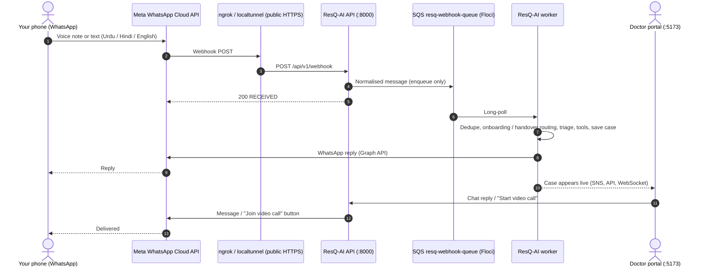

# ResQ-AI: Testing Locally with Your Own WhatsApp Phone

This is the **local development** guide: your phone talks to the Meta WhatsApp Cloud API, which calls your local backend through a tunnel. The provider setting is `WHATSAPP_PROVIDER=meta`.

Production on AWS uses AWS End User Messaging Social instead (`WHATSAPP_PROVIDER=eum_social`); see [End User Messaging Social (production)](#end-user-messaging-social-production) at the end.

---

## Overview of the flow



---

## Step 1: Get Meta WhatsApp Cloud API test credentials

1. Go to **[developers.facebook.com](https://developers.facebook.com)** and log in.
2. **My Apps** > **Create App**: choose the **Business** type, name it (for example `ResQ-Emergency-Test`), create it.
3. On the app dashboard, add the **WhatsApp** product (**Set up**).
4. In **WhatsApp** > **API Setup**, copy:
   - the **temporary access token** (starts with `EA...`; it expires after about a day, so use a system-user token for longer tests),
   - the **Phone number ID**,
   - the **test phone number**, and save it in your phone's contacts.
5. Register your own number as a test recipient: in the **To** dropdown, **Manage phone number list**, add your WhatsApp number with country code and enter the code Meta sends you. The test number can only message verified recipients.
6. Optional: in **App settings** > **Basic**, copy the **App secret**. Setting `WHATSAPP_APP_SECRET` makes the backend check the `X-Hub-Signature-256` header on every webhook call.

---

## Step 2: Configure ResQ-AI (root `.env`)

Secrets are no longer in `docker-compose.yml`. Compose reads them from a `.env` file in the repository root:

```bash
cp .env.example .env
```

Edit `.env`:
```ini
WHATSAPP_PROVIDER=meta
WHATSAPP_PHONE_NUMBER_ID=<your phone number ID>
WHATSAPP_ACCESS_TOKEN=<your access token>
WHATSAPP_VERIFY_TOKEN=resq_local_verify_token    # any string; you enter the same one in Meta
# Optional: enables the X-Hub-Signature-256 check
WHATSAPP_APP_SECRET=<your app secret>
```
`.env` is git-ignored. Never put tokens in `docker-compose.yml` or any committed file. (A Meta token that was committed in an earlier `docker-compose.yml` must be revoked in the Meta developer console.)

Start or restart the stack so both the API and the worker pick up the values:
```bash
docker compose up -d
docker compose logs backend worker | grep "WhatsApp"
```
You should see `[WhatsApp] Provider: meta (Graph API v20.0, phone number ID ...)`. If you see a warning about falling back to the **mock** provider, a value is missing: messages will be processed but nothing reaches your phone.

Running the backend without Docker? Put the same values in `backend/.env`. Note that with `MOCK_AWS=True` and no Floci there is no queue: the API processes messages inline and no worker is needed.

---

## Step 3: Expose the API to the internet

Meta needs a public HTTPS URL. In a new terminal:

```bash
ngrok http 8000
# Forwarding  https://xxxx.ngrok-free.app -> http://localhost:8000
```
or, without an account:
```bash
npx localtunnel --port 8000
```

---

## Step 4: Configure the webhook in Meta

1. **WhatsApp** > **Configuration** > **Webhook** > **Edit**.
2. **Callback URL**: `https://<your tunnel>/api/v1/webhook`
3. **Verify token**: the value of `WHATSAPP_VERIFY_TOKEN` from your `.env`.
4. **Verify and save**. The API answers Meta's `hub.challenge`.
5. Under **Webhook fields**, **Manage**, subscribe to **`messages`**.

---

## Step 5: Test from your phone

Open the chat with the Meta test number.

**1. First contact and onboarding.** Your number is unknown, so the backend creates a profile with no emergency contact and sends the onboarding prompt. Reply with your emergency contact in your own words, for example:
```text
My name is Ahmed, my brother Ali's number is 0333 1234567
```
You get a confirmation. No case is created. On AWS you can also say it in a voice note (Amazon Transcribe, then Bedrock reads it); locally Floci has neither, so a keyword reader handles typed replies and voice notes become human-review cases. A missing or incomplete number gets a reply asking for it. A greeting such as "Salam" also gets a reply but no case.

You don't have to register first: any other message (and every voice note) is triaged straight away. If no contact is registered, the contact call is skipped, the reply says so, and the onboarding prompt follows the emergency reply.

**2. An emergency.** Send a text, for example:
> *"Mere uncle ko dil ka daura par raha hai, seene me shadeed dard hai, please jaldi ambulance bhejein!"*

Locally the triage uses the keyword classifier (Floci has no Bedrock). For ESI 1-2 you get a reply with the (simulated) contact call and "a specialist is being contacted", followed by a **"Send location"** button. Nothing dispatches an ambulance automatically. The case is offered to the seeded doctors: accept it in the portal (**Accept for <doctor>** in the case's "Doctor offer" card) and your phone gets "Dr X accepted your case" with a **Request a call** button. Tapping it sends the doctor an **Open chat & call** link (to the seeded doctor's made-up number, so it shows in the worker log). ESI 3 gets urgent-care advice and an offer to one doctor for review, without a contact call; ESI 4-5 gets advice only. Messages are processed by the worker, so the reply takes a moment; watch `docker compose logs -f worker`.

**Voice notes locally:** Floci has no Amazon Transcribe. A real voice note is stored, then becomes a **"needs human review"** case (ESI 2, General Emergency doctor, no contact call, location requested) and you are asked to resend or type. Use text messages to test triage locally; real transcription only happens on AWS.

**Share your location.** Tap **Send location** under the emergency reply, or use 📎 (attach) > **Location** > **Send your current location** while the case is open. The location is saved on the case and shown in the console's "Patient location & ambulance" tile with a Google Maps link; the bot confirms who it was shared with. For an ESI 1-2 case it is also sent to your emergency contact as the WhatsApp template `resq_emergency_location`. That template must exist and be approved in the WABA you are testing with (with the Meta test number that is the Meta test WABA, not the End User Messaging Social one); otherwise the contact alert fails, which is expected, and the doctor sees "Could not send the location" in the chat. A location sent with no open case gets a short reply and creates nothing. In the console, **Mark ambulance called** records the doctor's call and sends you a WhatsApp message.

**3. Handover to the doctor.** Open [http://localhost:5173](http://localhost:5173) and select your case in the **Live Console**.
- While the case is open (ACTIVE or DOCTOR_HANDOVER), everything you send goes into the case chat for the doctor. There is no new triage and no tools run. Voice notes are kept and transcription is attempted (on AWS).
- A reply typed in the chat bridge arrives in your WhatsApp. The bot's own replies are also saved in the chat.
- **"Resolve case"** closes the case. Your next message starts a new triage.

**4. Video.** Click **"Start video call"**. You receive a **"Join video call"** button (the link is also in the text). In Docker the room is always simulated, because Chime only runs with real AWS. The link uses `PORTAL_BASE_URL` (`http://localhost:5173` in compose), which your phone cannot open; to open it on the phone, expose port 5173 with an HTTPS tunnel and set `PORTAL_BASE_URL` to that URL. Phone browsers block the camera and microphone on plain HTTP.

---

## Troubleshooting

- **Webhook verification fails:** the tunnel must point at port `8000`, and the verify token must match `WHATSAPP_VERIFY_TOKEN`.
- **401 on webhook calls:** `WHATSAPP_APP_SECRET` is set but does not match the app's secret. Fix it or leave it empty.
- **Nothing happens after a message:** check you subscribed to `messages`, then `docker compose logs worker`. Run `python scripts/test_floci.py` to see whether messages are stuck in `resq-webhook-queue` or have moved to the DLQ.
- **No reply on the phone:** the log shows the mock provider (missing token or phone number ID), the token expired, or your number is not in the test recipient list. WhatsApp also only allows free-form replies within 24 hours of the user's last message.
- **Message went into an old case's chat:** that number still has an open case. Resolve it in the portal.

---

## End User Messaging Social (production)

On AWS, WhatsApp goes through AWS End User Messaging Social: the number is linked in the End User Messaging Social console, inbound events go to SNS `resq-whatsapp-inbound-events`, then SQS, then the same worker, and replies are sent with `socialmessaging` `SendWhatsAppMessage` using the ECS task role (no Meta token). Terraform sets `WHATSAPP_PROVIDER=eum_social` and needs `eum_social_phone_number_id`. Setup steps: [`docs/deployment.md`](deployment.md) steps 5 and 7. This path works end to end with a real phone on the deployed stack; there, voice notes are transcribed by Amazon Transcribe, registrations are read by Bedrock, and doctor offers use the template `resq_doctor_case_offer` (approved by Meta), so they reach doctors who have not messaged the number. To receive offers on your own phone, register yourself as a doctor in the portal with your WhatsApp number; use a different number as the patient.
